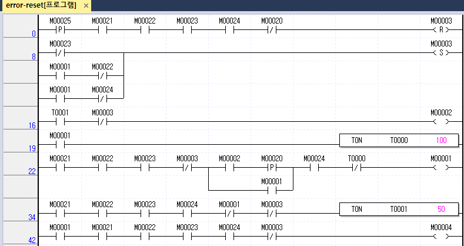
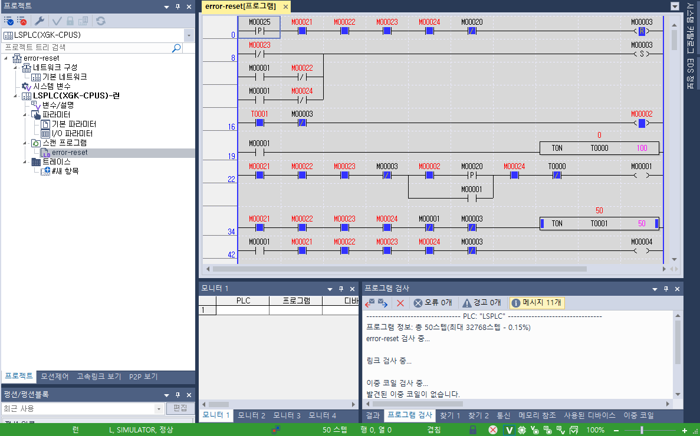
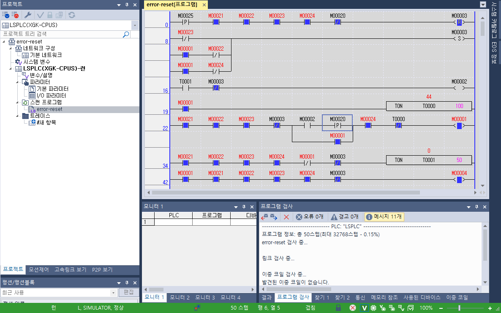
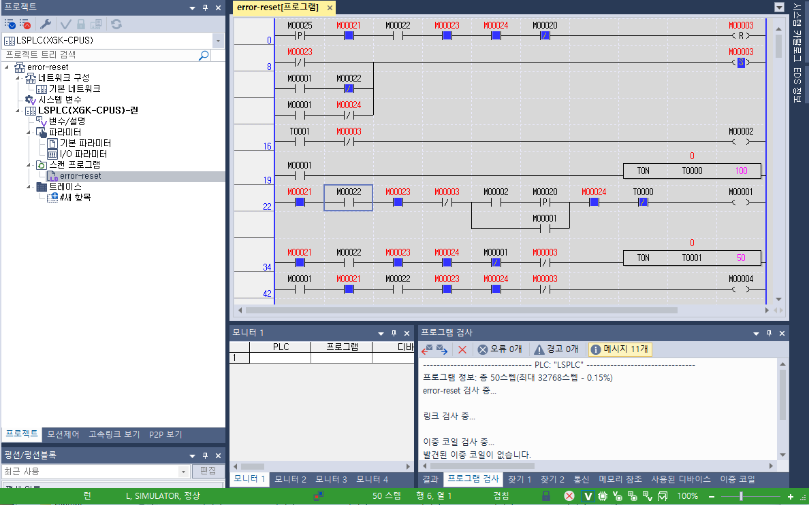
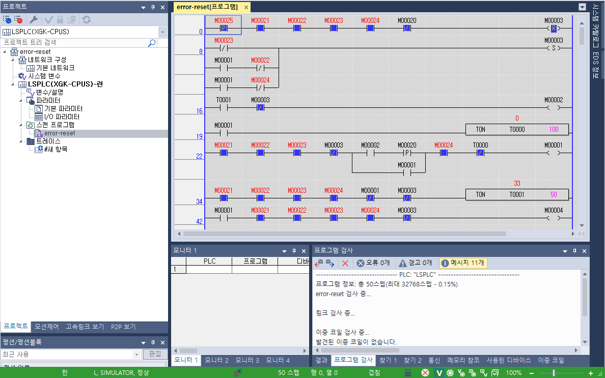

# PLC Error Latch & Manual Reset

## 프로젝트 개요

LS ELECTRIC XG5000의 래더 다이어그램(Ladder Diagram, LD)을 활용하여 **고장 래치 및 수동 복구 로직**을 구현한 프로젝트입니다.

기존 [Motor Control](../motor-control/) 회로에 ERROR 래치, 조건부 RESET, RUN 상태와 MOTOR 출력 분리를 추가했습니다.

## 1. 주요 구현 기능

| 기능 | 설명 |
|---|---|
| ERROR 래치 | 고장 원인이 사라져도 ERROR 상태 유지 |
| E-Stop 고장 검출 | 대기·준비·운전 상태에서 E-Stop 이상 발생 시 ERROR 기록 |
| 운전 중 고장 검출 | RUN 중 도어 열림 또는 센서 이상 발생 시 ERROR 기록 |
| 정상 정지 분리 | STOP 단독 조작은 ERROR를 생성하지 않고 운전 정지 |
| 조건부 수동 RESET | 정상 조건 충족 및 START 해제 상태에서 RESET으로 ERROR 해제 |
| RESET 상승 에지 검출 | RESET을 새로 누른 순간에만 복구 처리 |
| 복구 후 재대기 | ERROR 해제 후 정상 조건을 다시 5초간 유지해야 READY 활성화 |
| MOTOR 출력 분리 | RUN 상태와 별도로 최종 출력 허가 조건 확인 |

## 2. 고장 대응 및 복구 시퀀스

### ① 정상 대기 및 운전

정상 조건이 5초간 연속 유지되면 READY가 활성화됩니다.

READY 상태에서 새로운 START 상승 에지가 발생하면 RUN과 MOTOR가 활성화됩니다.

### ② 고장 발생

다음 조건 중 하나가 발생하면 ERROR를 SET합니다.

- E-Stop 이상
- RUN 중 도어 열림
- RUN 중 센서 이상

ERROR가 발생하면 RUN과 MOTOR를 차단하고, READY를 해제하며 READY 타이머를 초기화합니다.

대기 중 도어·센서 이상은 READY를 차단하지만 새로운 ERROR를 생성하지 않습니다.

### ③ 고장 원인 복구

E-Stop, 도어 또는 센서를 정상으로 복구해도 ERROR는 유지됩니다.

고장 원인 제거만으로 운전을 재개하지 않도록 구성했습니다.

### ④ 수동 RESET

다음 조건을 모두 만족한 상태에서 RESET을 새로 눌러야 ERROR가 해제됩니다.

- STOP_OK = 1
- DOOR_CLOSED = 1
- ESTOP_OK = 1
- SENSOR_OK = 1
- START = 0

고장이 남아 있거나 START를 누르고 있으면 RESET을 거부합니다.

RESET을 누른 채 고장 원인을 복구한 경우에도 버튼을 놓았다가 다시 눌러야 합니다.

### ⑤ 운전 준비 및 재시작

ERROR 해제 후 정상 조건을 다시 5초간 유지해야 READY가 활성화됩니다.

RESET 자체로 모터가 켜지지 않으며, 새로운 START 상승 에지가 발생해야 운전을 시작합니다.

## 3. PLC 디바이스 주소

| 디바이스 | 변수명 | 기능 |
|---|---|---|
| M00020 | START | 운전 시작 입력 |
| M00021 | STOP_OK | 정지 버튼 미작동 상태 |
| M00022 | DOOR_CLOSED | 도어 닫힘 상태 |
| M00023 | ESTOP_OK | 비상정지 정상 상태 |
| M00024 | SENSOR_OK | 센서 정상 상태 |
| M00025 | RESET | 수동 복구 입력 |
| M00001 | RUN | 운전 상태 비트 |
| M00002 | READY | 운전 준비 완료 비트 |
| M00003 | ERROR | 고장 래치 비트 |
| M00004 | MOTOR | 최종 모터 출력 명령 |
| T0000 | RUN Timer | 운전 10초 타이머 |
| T0001 | READY Timer | 운전 준비 5초 타이머 |

STOP·도어·E-Stop·센서의 정상 허가 신호는 `1`, 이상 또는 운전 불허 상태는 `0`으로 처리합니다.

`MOTOR`는 XG-SIM에서 확인하는 내부 출력 명령 비트입니다.

## 4. 래더 프로그램 구성

### ① ERROR RESET

RESET 상승 에지와 정상 조건을 직렬로 구성하여 `M00003(ERROR)`의 RESET 코일을 실행합니다.

- RESET: M00025 상승 에지 접점
- 정상 조건: M00021·M00022·M00023·M00024 NO 접점
- START 해제 조건: M00020 NC 접점
- 출력: M00003 RESET 코일 `(R)`

RESET 입력과 ERROR 해제 대상을 구분하여, 복구 버튼으로 고장 기록을 해제하도록 구성했습니다.

### ② ERROR SET

다음 세 경로를 병렬로 연결하여 하나의 `M00003(ERROR)` SET 코일을 구동합니다.

| 경로 | 접점 구성 |
|---|---|
| E-Stop 이상 | M00023 NC |
| RUN 중 도어 이상 | M00001 NO + M00022 NC 직렬 |
| RUN 중 센서 이상 | M00001 NO + M00024 NC 직렬 |

SET 코일은 고장 조건이 사라져도 ERROR를 유지하며, 유효한 RESET으로 해제합니다.

RESET 줄 다음에 고장 SET 줄을 배치하고, 고장 검출은 RUN 제어보다 먼저 실행하도록 구성했습니다. RUN이 차단되기 전에 운전 중 발생한 고장을 기록합니다.

### ③ READY 상태 출력

`T0001` 완료 접점과 `M00003(ERROR)` NC 접점을 직렬로 구성하여 `M00002(READY)`를 구동합니다.

ERROR가 유지되는 동안 READY는 활성화되지 않습니다.

### ④ RUN 타이머

`M00001(RUN)`이 활성화되면 `TON T0000 100`을 실행합니다.

프로젝트에서 사용한 100ms 시간 기준으로 10초 후 운전을 종료합니다.

### ⑤ RUN 제어 및 자기유지

START 경로와 RUN 자기유지 경로를 병렬로 구성했습니다.

- 시작 경로: READY + START 상승 에지
- 유지 경로: RUN 자기유지 접점
- 공통 조건: STOP·도어·E-Stop·센서 정상, ERROR 없음
- 자동 정지 조건: RUN 타이머 완료

READY는 시작 경로에만 적용하고, ERROR NC 접점은 시작·자기유지의 공통 경로에 적용했습니다.

### ⑥ READY 타이머

정상 허가 조건과 RUN·ERROR의 NC 접점을 직렬로 구성하여 `TON T0001 50`을 실행합니다.

운전 중이거나 ERROR가 유지되는 동안 타이머를 초기화하며, 복구 후 정상 조건 5초를 새로 계산합니다.

### ⑦ 최종 MOTOR 출력

다음 조건을 모두 만족할 때 `M00004(MOTOR)` 일반 코일을 활성화합니다.

`RUN AND STOP_OK AND DOOR_CLOSED AND ESTOP_OK AND SENSOR_OK AND NOT ERROR`

MOTOR 출력 줄은 프로그램 맨 아래에 배치하여, 고장 기록과 운전 상태 처리 후 최종 출력 조건을 확인합니다.

일반 코일을 사용하여 매 스캔 출력 허가 조건을 반영합니다.

## 5. 래더 프로그램 및 시뮬레이션

### 전체 래더 회로



RESET, ERROR SET, READY/RUN 제어 및 최종 MOTOR 출력으로 구성했습니다.

### READY 상태



- `M00003 = 0`: ERROR 없음
- `M00002 = 1`: READY 활성화
- `M00001 = 0`: RUN 비활성화
- `M00004 = 0`: MOTOR OFF
- `T0001 = 50`: 정상 조건 5초 완료

### RUN 상태



- `M00003 = 0`: ERROR 없음
- `M00001 = 1`: RUN 활성화
- `M00004 = 1`: MOTOR ON
- `T0000`: 운전 시간 증가
- `T0001 = 0`: READY 타이머 초기화

### 도어 복구 후 ERROR 유지



RUN 중 도어를 열었다가 다시 닫은 상태입니다.

정상 입력이 복구되어도 ERROR가 유지되며, READY·RUN·MOTOR는 차단됩니다.

### RESET 후 재대기



RESET으로 ERROR가 해제된 뒤 READY 타이머가 다시 증가하는 상태입니다.

RUN과 MOTOR는 OFF를 유지하며, 5초 완료 후 READY가 활성화됩니다.

## 6. 시뮬레이션 검증 결과

XG-SIM에서 입력을 직접 조작하고 상태 비트 및 타이머를 관찰했습니다.

| 시험 항목 | 확인 결과 | 판정 |
|---|---|---|
| 대기 중 E-Stop 이상 | ERROR 기록, READY·RUN 차단 | PASS |
| RUN 중 E-Stop 이상 | RUN 차단, ERROR 기록 | PASS |
| E-Stop 정상 복구 | RESET 전까지 ERROR 유지 | PASS |
| 고장 잔존 중 RESET | ERROR 해제 거부 | PASS |
| 정상 조건에서 수동 RESET | ERROR 해제, 자동 기동 없음 | PASS |
| RESET 후 운전 준비 | 정상 조건 5초 재대기 후 READY | PASS |
| 복구 후 새 START | RUN 시작 | PASS |
| RUN 중 도어 열림 | RUN 차단, ERROR 기록 | PASS |
| 도어 재닫힘 | ERROR 유지 | PASS |
| RUN 중 센서 이상 | RUN 차단, ERROR 기록 | PASS |
| 센서 정상 복구 | ERROR 유지 | PASS |
| 대기 중 도어·센서 이상 | READY 차단, ERROR 미생성 | PASS |
| 대기 중 도어·센서 정상 복구 | RESET 없이 5초 후 READY | PASS |
| STOP 단독 조작 | 정상 정지, ERROR 미생성 | PASS |
| STOP 정상 복구 | RESET 없이 5초 후 READY | PASS |
| START 누름 유지 중 RESET | ERROR 해제 거부 | PASS |
| START 해제 후 새 RESET | ERROR 해제 및 READY 재대기 | PASS |
| RESET 누름 유지 중 고장 복구 | ERROR 유지, 새 RESET 필요 | PASS |
| MOTOR 출력 | 대기 0 → 운전 1 → E-Stop 0 → RESET 후 0 | PASS |

## 7. 프로젝트 파일 구조

```text
error-reset/
├── README.md
├── src/
│   └── error-reset.xgwx
└── images/
    ├── ladder-overview.png
    ├── ready-monitor.png
    ├── run-monitor.png
    ├── door-fault-monitor.png
    └── reset-wait-monitor.png
```

- `src/`: XG5000 프로젝트 원본
- `images/`: 전체 래더 및 시뮬레이션 화면