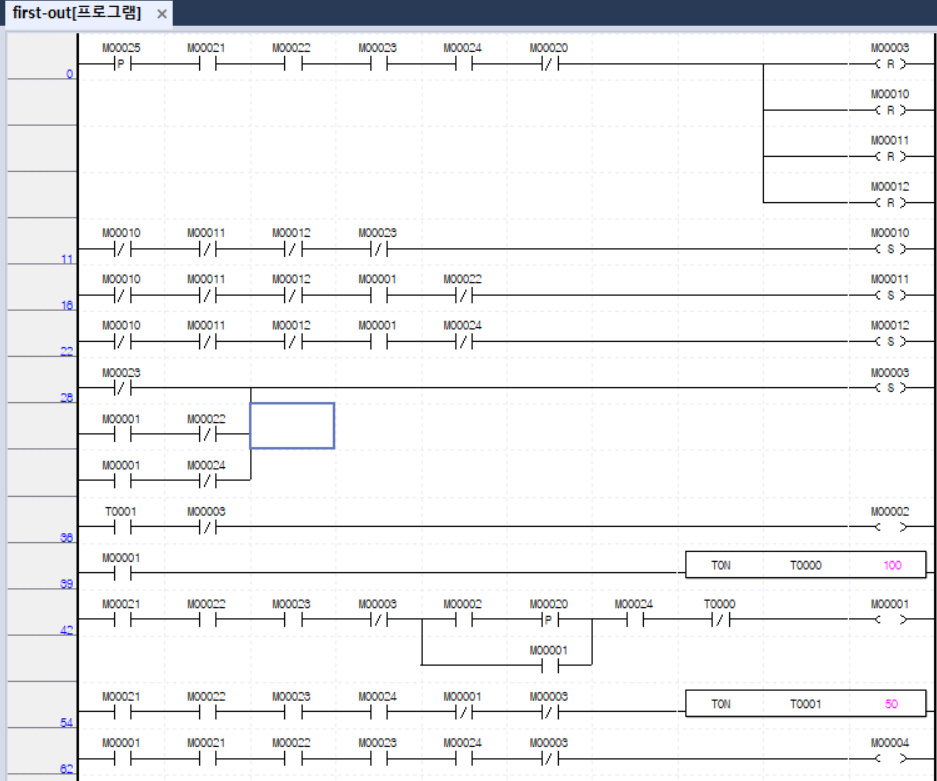
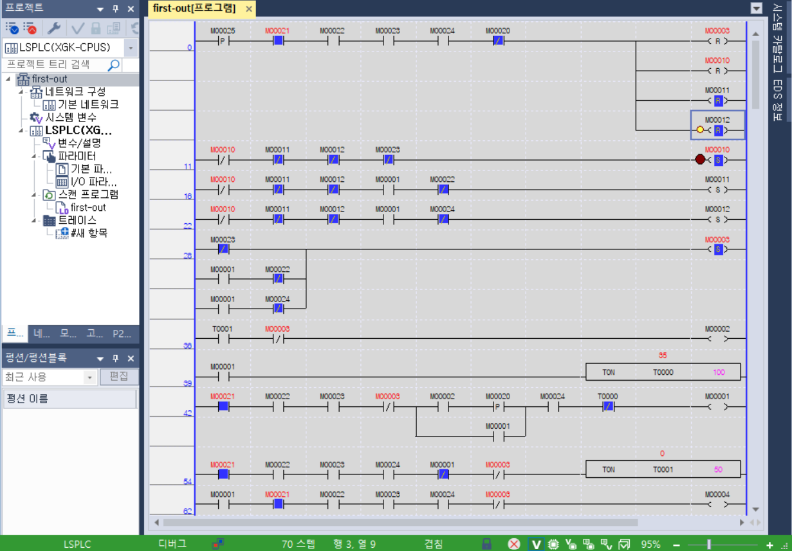
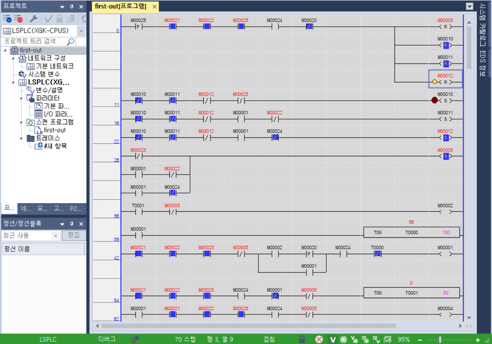
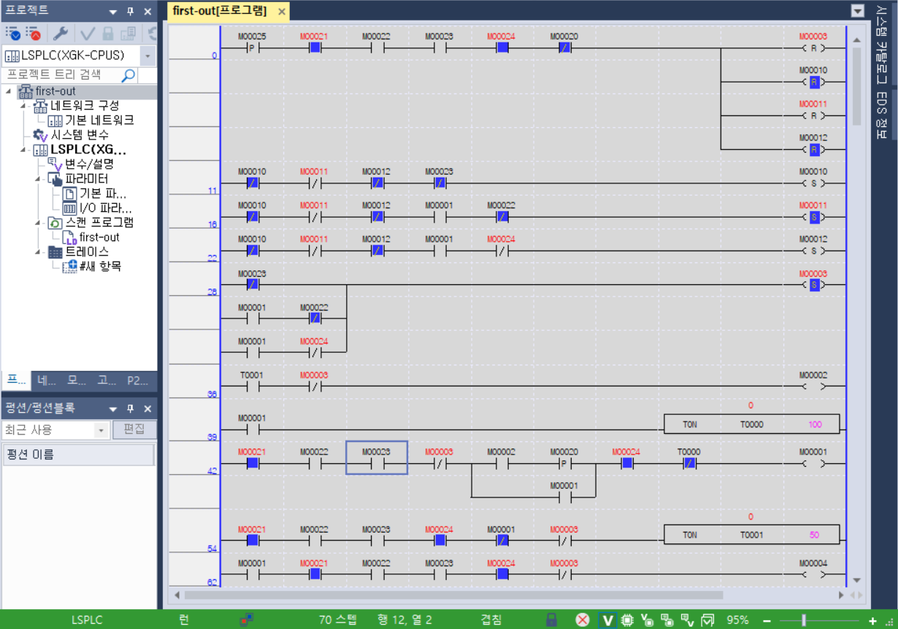
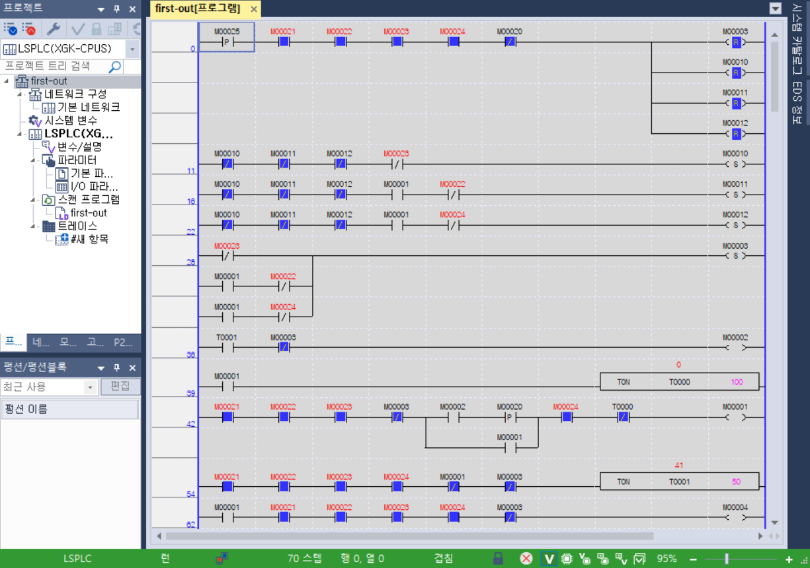

# PLC First-out Fault Recording

## 프로젝트 개요

LS ELECTRIC XG5000의 래더 다이어그램(Ladder Diagram, LD)으로 **최초 고장 원인 기록(First-out)** 기능을 구현한 프로젝트입니다.

기존 [Error Latch & Manual Reset](../error-reset/) 회로에 E-Stop·도어·센서별 기록 비트를 추가했습니다. 최초 고장 하나를 유지하여, 정지 이후 추가로 발생한 고장과 최초 정지 원인을 구분합니다.

개발 환경: **XG5000 v4.82.1 / XGK-CPUS / XG-SIM / Windows**

## 1. 주요 구현 기능

| 기능 | 설명 |
|---|---|
| 최초 고장 구분 | E-Stop·도어·센서를 개별 비트로 기록 |
| 최초 기록 유지 | 후속 고장이 발생하거나 입력이 정상 복구되어도 기존 기록 유지 |
| 동시 고장 우선순위 | 같은 스캔에서 복수 고장 검출 시 E-Stop → 도어 → 센서 순서로 선택 |
| 상태별 고장 검출 | E-Stop은 운전 여부와 관계없이 검출, 도어·센서는 RUN 중 검출 |
| 조건부 일괄 해제 | 유효한 RESET으로 ERROR와 최초 기록 3개를 함께 해제 |
| 정상 정지 분리 | STOP 단독 조작은 ERROR와 최초 고장 기록을 생성하지 않고 운전 정지 |
| 재시작 관리 | RESET 후 정상 조건 5초 재대기 및 새로운 START 상승 에지 필요 |

## 2. PLC 디바이스 주소

| 디바이스 | 변수명 | 기능 |
|---|---|---|
| M00020 | START | 운전 시작 입력 |
| M00021 | STOP_OK | 정지 버튼 미작동 상태 |
| M00022 | DOOR_CLOSED | 도어 닫힘 상태 |
| M00023 | ESTOP_OK | 비상정지 정상 상태 |
| M00024 | SENSOR_OK | 센서 정상 상태 |
| M00025 | RESET | 수동 복구 입력 |
| M00001 | RUN | 운전 상태 비트 |
| M00002 | READY | 운전 준비 완료 비트 |
| M00003 | ERROR | 공통 고장 래치 |
| M00004 | MOTOR | 최종 모터 출력 명령 |
| M00010 | FIRST_ESTOP | 최초 고장: E-Stop |
| M00011 | FIRST_DOOR | 최초 고장: 도어 |
| M00012 | FIRST_SENSOR | 최초 고장: 센서 |
| T0000 | RUN Timer | 운전 10초 타이머 — TON 100 |
| T0001 | READY Timer | 운전 준비 5초 타이머 — TON 50 |

STOP·도어·E-Stop·센서의 정상 허가 신호는 `1`, 이상 또는 운전 불허 상태는 `0`입니다. 타이머는 프로젝트의 100ms 시간 기준을 사용합니다. MOTOR는 XG-SIM에서 관찰하는 내부 출력 명령 비트입니다.

## 3. 최초 고장 기록 원리

### 공통 기록 허가 조건

세 기록 줄의 앞에 `M00010·M00011·M00012`의 NC 접점을 직렬로 배치했습니다.

NO(Normally Open) 접점은 해당 비트가 1일 때, NC(Normally Closed) 접점은 해당 비트가 0일 때 논리를 통과시킵니다.

`기록 허가 = NOT FIRST_ESTOP AND NOT FIRST_DOOR AND NOT FIRST_SENSOR`

세 비트가 모두 0일 때만 새 고장을 기록합니다. 하나라도 SET되면 모든 기록 줄의 허가 조건이 끊어져 기존 원인을 유지합니다.

최초 기록 비트는 현재 입력의 정상·이상 상태가 아니라, 유효한 RESET 전까지 보존하는 최초 고장 이력입니다.

### 원인별 SET 조건

| 실행 순서 | 기록 조건 | SET 대상 |
|---|---|---|
| ① | 기록 허가 + ESTOP_OK NC | M00010 FIRST_ESTOP |
| ② | 기록 허가 + RUN NO + DOOR_CLOSED NC | M00011 FIRST_DOOR |
| ③ | 기록 허가 + RUN NO + SENSOR_OK NC | M00012 FIRST_SENSOR |

E-Stop은 대기·준비·운전 상태에서 기록합니다. 도어·센서는 RUN 중 발생한 이상을 기록하며, 대기 중 이상은 READY를 차단합니다.

### 같은 스캔에서의 우선순위

최초 기록 줄은 **E-Stop → 도어 → 센서** 순서로 배치했습니다.

예를 들어 RUN 중 도어·센서 이상이 함께 평가되면 도어 줄에서 M00011이 먼저 SET됩니다. 아래 센서 줄에서는 M00011 NC 접점이 차단되어 M00012는 SET되지 않습니다.

세 고장이 함께 평가되면 M00010이 먼저 SET되어 도어·센서 기록을 차단합니다.

이 우선순위는 **기록이 없는 상태에서 같은 스캔에 복수 고장이 검출될 때** 적용됩니다. 이미 도어가 기록된 뒤 E-Stop이 발생해도 최초 도어 기록은 바뀌지 않습니다.

## 4. 래더 프로그램 구성

| 배치 순서 | 처리 내용 |
|---|---|
| ① | 조건부 RESET: ERROR 및 최초 기록 3개 해제 |
| ② | E-Stop 최초 기록 |
| ③ | 도어 최초 기록 |
| ④ | 센서 최초 기록 |
| ⑤ | 공통 ERROR SET |
| ⑥ | READY 상태 출력 |
| ⑦ | RUN 10초 타이머 |
| ⑧ | START 상승 에지·자기유지·인터록 기반 RUN 제어 |
| ⑨ | READY 5초 타이머 |
| ⑩ | 최종 MOTOR 출력 |

**최초 고장 기록을 RUN 제어보다 위에 배치**하여, RUN 비트가 차단되기 전에 운전 중 고장을 기록합니다.

공통 ERROR SET 조건은 `E-Stop 이상 OR (RUN AND 도어 이상) OR (RUN AND 센서 이상)`입니다. ERROR는 SET 코일로 유지하며, RUN과 MOTOR를 차단합니다.

MOTOR는 프로그램 맨 아래에서 다음 조건으로 구동합니다.

`RUN AND STOP_OK AND DOOR_CLOSED AND ESTOP_OK AND SENSOR_OK AND NOT ERROR`

## 5. 조건부 RESET 및 재시작

다음 조건을 모두 만족한 상태에서 RESET의 새로운 상승 에지가 발생해야 복구합니다.

- STOP_OK·DOOR_CLOSED·ESTOP_OK·SENSOR_OK = 1
- START = 0
- RESET = 0 → 1

위 조건을 지난 지점에서 병렬 분기하여 `M00003·M00010·M00011·M00012`의 RESET 코일 `(R)` 4개를 실행합니다. 모든 해제 코일이 동일한 복구 조건을 공유합니다.

고장이 남아 있거나 START를 누르고 있으면 ERROR와 최초 기록이 유지됩니다. RESET을 누른 채 고장을 복구해도 자동 해제되지 않으며, 버튼을 놓았다가 새로 눌러야 합니다.

유효한 RESET 후 RUN·MOTOR는 0을 유지합니다. 정상 조건을 다시 5초간 유지하여 READY가 활성화된 뒤, 새로운 START 상승 에지로 운전을 시작합니다.

## 6. XG-SIM 검증 결과

2026년 11월 7일 XG-SIM에서 입력·상태 비트와 타이머를 관찰하여 확인했습니다.

| 시험 항목 | 확인 결과 | 판정 |
|---|---|---|
| 대기 중 E-Stop 단독 이상 | ERROR=1, FIRST_ESTOP=1, 나머지 기록=0 | PASS |
| E-Stop 정상 복구 | ERROR·FIRST_ESTOP 유지 | PASS |
| 유효한 RESET | ERROR·최초 기록 모두 0, RUN·MOTOR=0 | PASS |
| RESET 후 준비 | 정상 조건 5초 재대기 후 READY=1 | PASS |
| RUN 중 도어 이상 | FIRST_DOOR만 1, ERROR=1, RUN·MOTOR=0 | PASS |
| 도어 기록 후 E-Stop 추가 | FIRST_DOOR 유지, FIRST_ESTOP=0 | PASS |
| 고장 잔존 중 RESET | ERROR·최초 기록 해제 거부 | PASS |
| RESET 누름 유지 중 정상 복구 | ERROR·최초 기록 유지 | PASS |
| 정상 복구 후 새로운 RESET | ERROR·최초 기록 일괄 해제 | PASS |
| RUN 중 센서 이상 | FIRST_SENSOR만 1, ERROR=1, RUN·MOTOR=0 | PASS |
| 센서 정상 복구 | ERROR·FIRST_SENSOR 유지 | PASS |
| START 누름 중 RESET | ERROR·FIRST_SENSOR 유지 | PASS |
| START 해제 후 새로운 RESET | ERROR·최초 기록 일괄 해제 | PASS |
| 대기 중 도어·센서 개별 이상 | ERROR·최초 기록 모두 0, READY 차단 | PASS |
| 대기 중 도어·센서 정상 복구 | RESET 없이 5초 후 READY=1 | PASS |
| RUN 중 도어·센서 동시 이상 | FIRST_DOOR만 1, ERROR=1, RUN·MOTOR=0 | PASS |
| RUN 중 세 고장 동시 발생 | FIRST_ESTOP만 1, ERROR=1, RUN·MOTOR=0 | PASS |

### 동시 고장 시험 방법

디버그 실행이 멈춘 상태에서 시험용 현재값을 설정한 뒤 실행을 재개했습니다. RUN 비트를 직접 1로 설정하여 운전 중 고장 검출 직전 상태를 구성했습니다.

| 시험 조건 | 도어·센서 동시 | 세 고장 동시 |
|---|---:|---:|
| START / RESET | 0 / 0 | 0 / 0 |
| STOP_OK | 1 | 1 |
| ESTOP_OK | 1 | 0 |
| DOOR_CLOSED / SENSOR_OK | 0 / 0 | 0 / 0 |
| ERROR 및 최초 기록 3개 | 모두 0 | 모두 0 |
| RUN | 1 | 1 |
| 실행 후 최초 기록 | FIRST_DOOR=1 | FIRST_ESTOP=1 |

실행을 멈춘 동안 입력을 설정하여 복수 고장이 같은 스캔의 기록 로직에서 함께 평가되도록 했습니다. 시험 후 정상 운전 모드로 복귀했습니다.

## 7. 래더 회로 및 시뮬레이션 화면

### 전체 래더 회로

조건부 RESET, 최초 고장 기록, ERROR 래치, READY/RUN 제어 및 MOTOR 출력으로 구성했습니다.

### 도어·센서 동시 고장

도어·센서가 동시에 이상일 때 FIRST_DOOR만 기록됩니다. ERROR는 1, RUN·MOTOR는 0입니다.

### 세 고장 동시 발생

E-Stop·도어·센서가 동시에 이상일 때 FIRST_ESTOP만 기록됩니다.

### 센서 단독 고장

센서 단독 이상으로 FIRST_SENSOR와 ERROR가 SET되고 RUN·MOTOR가 차단됩니다.

### 후속 고장 발생 시 최초 기록 유지

도어가 먼저 기록된 뒤 E-Stop이 발생해도 FIRST_DOOR가 유지되며 FIRST_ESTOP은 0입니다.

### RESET 후 재대기

ERROR와 최초 기록 3개가 모두 해제되고 READY 타이머가 다시 증가합니다. 캡처의 T0001은 41이며 RUN·MOTOR·READY는 0입니다.
