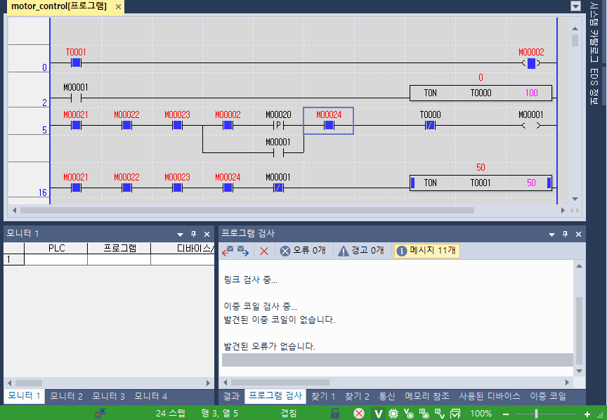

# PLC Motor Control

## 프로젝트 개요

LS ELECTRIC XG5000의 래더 다이어그램(Ladder Diagram, LD)을 활용하여 **모터 운전 시퀀스 및 인터록(Interlock) 제어 로직**을 구현한 프로젝트입니다.

START/STOP 입력에 따른 자기유지(Self-Holding), 타이머 기반 운전 준비 및 자동 정지, 상승 에지(Rising Edge) 검출, 운전 허가 조건과 인터록을 적용했습니다.

## 1. 주요 구현 기능

| 기능 | 설명 |
|---|---|
| START/STOP 제어 | START 명령으로 운전 시작, STOP 조건 해제 시 정지 |
| 자기유지(Self-Holding) | START 입력이 해제되어도 RUN 상태 유지 |
| READY 타이머 | 정상 조건이 5초간 연속 유지되면 운전 준비 완료 |
| RUN 타이머 | 운전 시작 후 10초 경과 시 자동 정지 |
| 상승 에지 검출 | START 입력의 OFF → ON 전환 시점에만 시작 명령 처리 |
| 인터록(Interlock) | 도어·비상정지·센서 상태에 따른 운전 차단 |
| 시작 허가와 운전 유지 분리 | READY는 운전 시작 조건으로만 적용하고, RUN은 별도 자기유지 경로로 유지 |

## 2. 모터 운전 시퀀스

### ① 초기 대기

STOP, 도어, 비상정지, 센서의 정상 조건을 확인합니다.

### ② READY 활성화

모든 정상 조건을 5초간 연속 유지하면 READY가 활성화됩니다.

대기 중 정상 조건이 해제되면 READY 타이머가 초기화됩니다.

### ③ 운전 시작

READY 상태에서 START 입력의 상승 에지가 검출되면 RUN이 활성화됩니다.

### ④ 운전 유지

RUN은 자기유지 회로를 통해 유지됩니다.

운전이 시작되면 READY는 해제되지만, READY와 RUN 유지 경로를 분리하여 운전 상태가 지속되도록 구성했습니다.

### ⑤ 운전 종료

RUN이 활성화되면 10초 타이머가 동작합니다.

10초 경과 시 RUN을 자동 정지하며, 운전 중 STOP 또는 인터록 정상 조건이 해제되어도 RUN이 차단됩니다.

### ⑥ 재시작 대기

RUN 종료 후 정상 조건을 다시 5초간 유지해야 READY가 활성화됩니다.

이후 새로운 START 상승 에지가 발생해야 다음 운전을 시작합니다.

## 3. PLC 디바이스 주소

| 디바이스 | 변수명 | 기능 |
|---|---|---|
| M00020 | START | 운전 시작 입력 |
| M00021 | STOP_OK | 정지 입력 정상 상태 |
| M00022 | DOOR_CLOSED | 도어 닫힘 상태 |
| M00023 | ESTOP_OK | 비상정지 정상 상태 |
| M00024 | SENSOR_OK | 센서 정상 상태 |
| M00001 | RUN | 모터 운전 명령 비트 |
| M00002 | READY | 운전 준비 완료 비트 |
| T0000 | RUN Timer | 운전 10초 타이머 |
| T0001 | READY Timer | 운전 준비 5초 타이머 |

정상 조건은 `1`, 이상 또는 운전 불허 조건은 `0`으로 처리합니다.

## 4. 래더 프로그램 구성

### Network 0 — READY 상태 출력

READY 타이머 `T0001`의 완료 접점을 이용하여 `M00002(READY)`를 활성화합니다.

### Network 2 — RUN 타이머

`M00001(RUN)`이 활성화되면 `TON T0000 100`을 실행합니다.

타이머 설정값 100은 100ms 시간 기준으로 10초에 해당합니다.

### Network 5 — RUN 제어 및 자기유지

START 입력 경로와 RUN 자기유지 경로를 병렬로 구성했습니다.

- 시작 경로: READY 타이머 완료 접점 + START 상승 에지
- 유지 경로: RUN 자기유지 접점
- 공통 조건: STOP, DOOR, E-STOP, SENSOR 정상 상태
- 자동 정지 조건: RUN 타이머 완료 시 자기유지 차단

READY를 시작 경로에만 적용하여 운전 시작 후 READY가 해제되더라도 RUN 자기유지가 유지되도록 구성했습니다.

### Network 16 — READY 타이머

STOP, DOOR, E-STOP, SENSOR가 모두 정상이고 RUN이 비활성화된 상태에서 `TON T0001 50`을 실행합니다.

정상 조건이 5초간 연속 유지되면 READY 타이머가 완료됩니다.

## 5. 래더 프로그램 및 시뮬레이션

### READY 상태 모니터링



정상 조건이 5초간 유지되어 READY 타이머가 완료된 상태입니다.

- `T0001 = 50` : READY 타이머 완료
- `M00002 = 1` : READY 활성화
- `M00001 = 0` : RUN 비활성화

## 6. 프로젝트 파일 구조

```text
motor-control/
├── README.md
├── src/
│   └── [XG5000 프로젝트 원본]
└── images/
    └── ready-monitor.png
```

- `src/`: XG5000 프로젝트 원본 파일
- `images/`: 래더 회로 및 시뮬레이션 화면